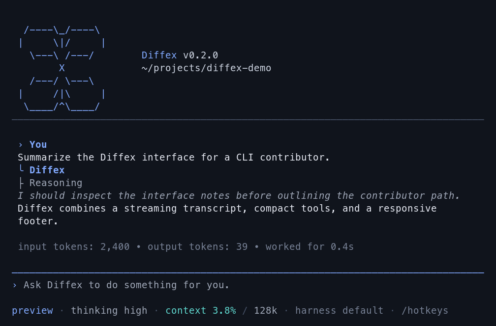

<p align="center">
  <a href="https://diffex.ai/">
    
  </a>
</p>
<p align="center">
  <a href="https://www.npmjs.com/package/@diffexai/diffex"></a>
</p>

> New issues and PRs from new contributors are auto-closed by default. Maintainers review auto-closed issues daily. See [CONTRIBUTING.md](../../CONTRIBUTING.md).

---

Diffex is a minimal terminal coding harness. Adapt Diffex to your workflows, not the other way around, without having to fork and modify Diffex internals. Extend it with TypeScript [Extensions](#extensions), [Skills](#skills), [Prompt Templates](#prompt-templates), and [Themes](#themes). Put your extensions, skills, prompt templates, and themes in [Diffex Packages](#diffex-packages) and share them with others via npm or git.

Diffex ships with powerful defaults, including session-scoped sub-agents and an interactive Plan mode. You can adapt or replace workflows with extensions and third-party Diffex packages.

Diffex runs in four modes: interactive, print or JSON, RPC for process integration, and an SDK for embedding in your own apps.

## Table of Contents

- [Quick Start](#quick-start)
- [Providers & Models](#providers--models)
- [Interactive Mode](#interactive-mode)
  - [Editor](#editor)
  - [Commands](#commands)
  - [Keyboard Shortcuts](#keyboard-shortcuts)
  - [Plan Mode](#plan-mode)
  - [Message Queue](#message-queue)
- [Sessions](#sessions)
  - [Branching](#branching)
  - [Compaction](#compaction)
- [Settings](#settings)
- [Context Files](#context-files)
- [Customization](#customization)
  - [Prompt Templates](#prompt-templates)
  - [Skills](#skills)
  - [Extensions](#extensions)
  - [Themes](#themes)
  - [Diffex Packages](#diffex-packages)
- [Programmatic Usage](#programmatic-usage)
- [Philosophy](#philosophy)
- [CLI Reference](#cli-reference)

---

## Quick Start

```bash
npm install -g --ignore-scripts @diffexai/diffex
```

`--ignore-scripts` disables dependency lifecycle scripts during install. Diffex does not require install scripts for normal npm installs.

Authenticate with an API key:

```bash
export ANTHROPIC_API_KEY=sk-ant-...
diffex
```

Or use your existing subscription:

```bash
diffex
/login  # Then select provider
```

Then just talk to Diffex. By default, Diffex gives the model five tools: `read`, `write`, `edit`, `bash`, and `update_plan`. The model uses these to fulfill your requests and keep multi-step work visible. Add capabilities via [skills](#skills), [prompt templates](#prompt-templates), [extensions](#extensions), or [Diffex packages](#diffex-packages).

**Platform notes:** [Windows](docs/windows.md) | [Termux (Android)](docs/termux.md) | [tmux](docs/tmux.md) | [Terminal setup](docs/terminal-setup.md) | [Shell aliases](docs/shell-aliases.md)

---

## Providers & Models

For each built-in provider, Diffex maintains a list of tool-capable models. Configured provider catalogs refresh automatically; run `diffex update --models` to force an immediate refresh. Authenticate via subscription (`/login`) or API key, then select any model from that provider via `/model` (or Ctrl+L).

**Subscriptions:**
- Anthropic Claude Pro/Max
- OpenAI ChatGPT Plus/Pro (Codex)
- GitHub Copilot

**API keys:**
- Anthropic
- Ant Ling
- OpenAI
- Azure OpenAI
- DeepSeek
- NVIDIA NIM
- Google Gemini
- Google Vertex
- Amazon Bedrock
- Mistral
- Groq
- Cerebras
- Cloudflare AI Gateway
- Cloudflare Workers AI
- xAI
- OpenRouter
- Vercel AI Gateway
- ZAI Coding Plan (Global)
- ZAI Coding Plan (China)
- OpenCode Zen
- OpenCode Go
- Hugging Face
- Fireworks
- Together AI
- Baseten
- Kimi For Coding
- MiniMax
- Xiaomi MiMo
- Xiaomi MiMo Token Plan (China)
- Xiaomi MiMo Token Plan (Amsterdam)
- Xiaomi MiMo Token Plan (Singapore)

Diffex also supports the llama.cpp router server. Configure it with `/login llama.cpp`, manage downloads and loaded models with `/llama`, then select a loaded model with `/model`. See [docs/llama-cpp.md](docs/llama-cpp.md) for setup and usage.

See [docs/providers.md](docs/providers.md) for other provider setup instructions.

**Custom providers & models:** Add providers via `~/.diffex/agent/models.json` if they speak a supported API (OpenAI, Anthropic, Google). For custom APIs or OAuth, use extensions. See [docs/models.md](docs/models.md) and [docs/custom-provider.md](docs/custom-provider.md).

---

## Interactive Mode

<p align="center"></p>

The interface from top to bottom:

- **Startup header** - Shows shortcuts (`/hotkeys` for all), loaded AGENTS.md files, prompt templates, skills, and extensions
- **Messages** - Your messages, assistant responses, tool calls and results, notifications, errors, and extension UI
- **Editor** - Where you type; border color indicates thinking level
- **Footer** - Working directory, session name, total token/cache usage (`↑` input, `↓` output, `R` cache read, `W` cache write, `CH` latest cache hit rate), cost, context usage, current model. Totals include assistant responses, usage reported by tools, and summary generation.

The editor can be temporarily replaced by other UI, like built-in `/settings` or custom UI from extensions (e.g., a Q&A tool that lets the user answer model questions in a structured format). [Extensions](#extensions) can also replace the editor, add widgets above/below it, a status line, custom footer, or overlays.

### Editor

| Feature | How |
|---------|-----|
| File reference | Type `@` to fuzzy-search project files |
| Path completion | Tab to complete paths |
| Multi-line | Shift+Enter (or Ctrl+Enter on Windows Terminal) |
| External editor | Ctrl+G opens `externalEditor`, `$VISUAL`, `$EDITOR`, Notepad on Windows, or `nano` elsewhere |
| Clipboard | Ctrl+V to paste an image or text (Alt+V on Windows), or drag images onto terminal |
| Bash commands | `!command` runs and sends output to LLM, `!!command` runs without sending |

Standard editing keybindings for delete word, undo, etc. See [docs/keybindings.md](docs/keybindings.md).

### Commands

Type `/` in the editor to trigger commands. [Extensions](#extensions) can register custom commands, [skills](#skills) are referenced through `/skills`, and [prompt templates](#prompt-templates) expand via `/templatename`.

| Command | Description |
|---------|-------------|
| `/login`, `/logout` | Manage provider credentials |
| [`/llama`](docs/llama-cpp.md) | Download, load, and unload llama.cpp router models |
| `/model` | Select a model, then its thinking level |
| `/scoped-models` | Enable/disable models for Ctrl+P cycling |
| `/settings` | Theme, installed skills, message delivery, transport |
| `/plan [request]` | Enter Plan mode, optionally submitting a planning request |
| [`/skills`](docs/skills.md#skill-commands) | Search and reference one or more skills in the editor |
| [`/evolve`](docs/evolution.md) | Inspect and control harness evolution and generated skills |
| [`/version`](docs/evolution.md#controls) | Select the active harness revision |
| `/resume` | Pick from previous sessions |
| `/new` | Start a new session |
| `/name <name>` | Set session display name |
| `/session` | Show session info (file, ID, messages, tokens, cost) |
| `/subagents` | Show all sub-agents in the current session |
| `/tree` | Jump to any point in the session and continue from there |
| `/trust` | Save project trust decision for future sessions (restart required) |
| `/fork` | Create a new session from a previous user message |
| `/clone` | Duplicate the current active branch into a new session |
| `/compact [prompt]` | Manually compact context, optional custom instructions |
| `/copy` | Copy last assistant message to clipboard |
| `/export [file]` | Export session to HTML or JSONL file |
| `/import <file>` | Import and resume a session from a JSONL file |
| `/share` | Upload as a secret GitHub Gist and return its direct URL |
| `/reload` | Reload keybindings, extensions, skills, prompts, themes, and context files |
| `/hotkeys` | Show all keyboard shortcuts |
| `/changelog` | Display version history |
| `/quit` | Quit Diffex |

`/subagents` runs immediately, including while the parent agent is working or compacting.
It displays the current in-memory roster without adding the command or roster to model context.

### Keyboard Shortcuts

See `/hotkeys` for the full list. Customize via `~/.diffex/agent/keybindings.json`. See [docs/keybindings.md](docs/keybindings.md).

**Commonly used:**

| Key | Action |
|-----|--------|
| Ctrl+C | Clear editor |
| Ctrl+C twice | Quit |
| Escape | Cancel/abort |
| Escape twice | Open `/tree` |
| Ctrl+L | Open model selector |
| Ctrl+P / Shift+Ctrl+P | Cycle scoped models forward/backward |
| Shift+Tab | Toggle Default and Plan collaboration modes |
| Ctrl+O | Collapse/expand tool output |
| Ctrl+T | Collapse/expand thinking blocks |
| Ctrl+X | Copy the last assistant message |

Use `/model` or Ctrl+L to select a model, then choose its thinking level when multiple levels are supported. Selecting the current model also opens the thinking selector. Escape keeps the selected model and its current supported level. Thinking-level cycling has no default shortcut; bind `app.thinking.cycle` in `keybindings.json` to enable one.

### Plan Mode

Plan mode is an interactive, evidence-first workflow for producing a decision-complete implementation plan without carrying it out. Press Shift+Tab or run `/plan`; `/plan <request>` enters Plan mode and submits the request. The footer identifies the active mode.

The model first inspects available evidence and distinguishes discoverable facts from preferences only you can decide. Its model-visible tools are restricted to the invocation's allowed, trusted pre-extension implementations of `read`, `grep`, `find`, and `ls`, plus `request_user_input` when permitted. Mutating, extension, custom, and execution-time tools such as `bash`, `edit`, `write`, and `update_plan` are unavailable. This is a model-tool boundary, not a filesystem sandbox: direct `!` commands and extension side effects remain outside it.

For material choices, `request_user_input` can show one to three questions. Each has two or three choices plus **Other** for a free-form answer. Answer every question to submit, or cancel to return a non-fatal cancellation result while staying in Plan mode. If the tool is filtered out or a choice list is unsuitable, the model asks an ordinary conversational question instead.

The official response must contain exactly one non-empty plan between standalone `<proposed_plan>` and `</proposed_plan>` lines outside fenced code. On a valid completed response, Diffex removes only those tag lines and stores and displays the remaining Markdown normally. After the run settles, choose **Implement the plan** to switch to Default and submit `Implement the plan.` in the same session, or **Stay in Plan mode** to dismiss the offer. Queued input suppresses the offer; an unrelated modal defers it. If implementation submission fails, Diffex remains in Default and restores the exact submission text to the editor.

Plan mode is an interactive branch preference. Resume, fork, and `/tree` navigation restore the newest matching mode entry on the selected branch when it is valid; new sessions, malformed newest matching entries, and non-interactive print, JSON, RPC, and SDK use remain in Default. Historical plans never replay the implementation offer. `update_plan` is a separate execution-time progress checklist and does not enter or leave Plan mode.

Mode changes use normal lazy session saving: toggling in a new disk-backed session remains in memory until its first assistant message is saved or the session is explicitly persisted. Starting a new run discards an older implementation offer, including when an extension starts the run. Temporary busy activity defers the offer and blocks acceptance until idle, including awaited direct-Bash extension hooks. See [Plan mode details](docs/usage.md#plan-mode).

### Message Queue

Submit messages while the agent is working:

- **Enter** queues a *steering* message, delivered after the current assistant turn finishes executing its tool calls
- **Alt+Enter** queues a *follow-up* message, delivered only after the agent finishes all work
- **Escape** aborts and restores queued messages to editor
- **Alt+Up** retrieves queued messages back to editor

On Windows Terminal, `Alt+Enter` is fullscreen by default. Remap it in [docs/terminal-setup.md](docs/terminal-setup.md) so Diffex can receive the follow-up shortcut.

Configure delivery in [settings](docs/settings.md): `steeringMode` and `followUpMode` can be `"one-at-a-time"` (default, waits for response) or `"all"` (delivers all queued at once). `transport` selects provider transport preference (`"sse"`, `"websocket"`, or `"auto"`) for providers that support multiple transports.

### Harness Evolution

`/evolve` shows evidence eligibility, jobs, memory proposals, generated skill candidates, readable supporting and contradicting evidence, draft diffs, validation, evaluation, target revisions, activation, and rollback. `/version` selects a complete immutable harness revision. Memory and evolved skills change together at regular session construction, an idle prompt boundary, an idle reload, or successful manual compaction without a queued continuation; in-flight and admitted queued requests remain pinned. The footer shows the active harness and background activity. See [Harness Evolution](docs/evolution.md).

---

## Sessions

Sessions are stored as JSONL files with a tree structure. Each entry has an `id` and `parentId`, enabling in-place branching without creating new files. See [docs/session-format.md](docs/session-format.md) for file format.

The built-in `update_plan` tool stores an ordered plan with stable step IDs and optional `success_criteria` in the session.
It can replace the plan, update one step by ID, or clear the plan.
Every model request ends with hidden current-task context containing the latest plan, including after resume and compaction.
The plan records progress; it does not execute, gate, verify, or prove work.

The selected collaboration mode is stored separately as an interactive branch preference. Resume, fork, and `/tree` navigation restore it from the selected branch; non-interactive modes always use Default and do not overwrite that preference.

### Management

Sessions auto-save to `~/.diffex/agent/sessions/` organized by working directory.

```bash
diffex -c                  # Continue most recent session
diffex -r                  # Browse and select from past sessions
diffex --no-session        # Ephemeral mode (don't save)
diffex --name "my task"    # Set session display name at startup
diffex --session <path|id> # Use specific session file or ID
diffex --fork <path|id>    # Fork specific session file or ID into a new session
```

Use `/session` in interactive mode to see the current session ID before reusing it with `--session <id>` or `--fork <id>`.

### Branching

**`/tree`** - Navigate the session tree in-place. Select any previous point, continue from there, and switch between branches. All history preserved in a single file.

<p align="center"></p>

- Search by typing, fold/unfold and jump between branches with Ctrl+←/Ctrl+→ or Alt+←/Alt+→, page with ←/→
- Filter modes (Ctrl+O): default → no-tools → user-only → labeled-only → all
- Press Ctrl+X to copy the selected message
- Press Shift+L to label entries as bookmarks and Shift+T to toggle label timestamps

**`/fork`** - Create a new session file from a previous user message on the active branch. Opens a selector, copies the active path up to that point, and places the selected prompt in the editor for modification.

**`/clone`** - Duplicate the current active branch into a new session file at the current position. The new session keeps the full active-path history and opens with an empty editor.

**`--fork <path|id>`** - Fork an existing session file or partial session UUID directly from the CLI. This copies the full source session into a new session file in the current project.

### Compaction

Long sessions can exhaust context windows. Compaction summarizes older messages while keeping recent ones.

**Manual:** `/compact` or `/compact <custom instructions>`

**Automatic:** Enabled by default. Triggers on context overflow (recovers and retries) or when approaching the limit (proactive). Configure via `/settings` or `settings.json`.

Compaction is lossy. The full history remains in the JSONL file; use `/tree` to revisit. Customize compaction behavior via [extensions](#extensions). See [docs/compaction.md](docs/compaction.md) for internals.

---

## Settings

Use `/settings` to modify common options, or edit JSON files directly:

| Location | Scope |
|----------|-------|
| `~/.diffex/agent/settings.json` | Global (all projects) |
| `.diffex/settings.json` | Project (overrides global) |

See [docs/settings.md](docs/settings.md) for all options.

### Project Trust

On interactive startup, Diffex asks before trusting a project folder that contains project-local settings, resources, or project `.agents/skills` and has no saved decision for the folder or a parent folder in `~/.diffex/agent/trust.json`. Trusting a project allows Diffex to load `.diffex/settings.json` and `.diffex` resources, install missing project packages, and execute project extensions.

Before the trust decision, Diffex loads only context files, user/global extensions, and CLI `-e` extensions so they can handle the `project_trust` event. Project-local extensions, project package-managed extensions, and project settings are loaded only after the project is trusted. This split also applies when switching to a session from a different cwd whose trust has not been resolved in the current process.

Non-interactive modes (`-p`, `--mode json`, and `--mode rpc`) do not show a trust prompt. Without an applicable saved trust decision, they use `defaultProjectTrust` from global settings: `ask` (default) and `never` ignore those project resources, while `always` trusts them. Pass `--approve`/`-a` or `--no-approve`/`-na` to override project trust for one run.

If no extension or saved decision applies, `defaultProjectTrust` controls the fallback behavior. Set it to `"ask"`, `"always"`, or `"never"` in `~/.diffex/agent/settings.json`, or change it with `/settings`.

`diffex config` and package commands use the same project trust flow, except `diffex update` never prompts. Pass `--approve` to trust project-local settings for one command or `--no-approve` to ignore them.

Use `/trust` in interactive mode to save a project trust decision for future sessions, including trust for the immediate parent folder. It writes `~/.diffex/agent/trust.json` only; the current session is not reloaded, so restart Diffex for changes to take effect.

### Provider attribution and update checks

Diffex does not send install or update telemetry reports.
The former `enableInstallTelemetry` setting and `DIFFEX_TELEMETRY` variable are no longer used.

Optional attribution headers for OpenRouter, Cloudflare, and direct NVIDIA NIM requests have a separate `enableProviderAttribution` setting, which defaults to `false`.
Enable it through **Provider attribution** in `/settings`, or override it with `DIFFEX_PROVIDER_ATTRIBUTION=1` (`0` disables it).
This control does not affect update checks, OpenCode session headers, or explicitly configured request headers.

Startup update checks query `https://api.diffex.ai/api/latest-version`.
Disable automatic checks with `DIFFEX_SKIP_VERSION_CHECK=1`.
Use `--offline` or `DIFFEX_OFFLINE=1` to disable startup network operations, including update checks and package update checks.

---

## Context Files

Diffex loads `AGENTS.md` (or `CLAUDE.md`) at startup from:
- `~/.diffex/agent/AGENTS.md` (global)
- Parent directories (walking up from cwd)
- Current directory

If a directory contains `AGENTS.override.md`, Diffex loads it instead of `AGENTS.md` or `CLAUDE.md` from that directory. Context files from other directories are still concatenated.

Use for project instructions (`AGENTS.md`/`CLAUDE.md`), conventions, common commands. All matching files are concatenated.

Disable context file loading with `--no-context-files` (or `-nc`).

### System Prompt

Replace the default system prompt with `.diffex/SYSTEM.md` (project) or `~/.diffex/agent/SYSTEM.md` (global). Append without replacing via `APPEND_SYSTEM.md`.

---

## Customization

### Prompt Templates

Reusable prompts as Markdown files. Type `/name` to expand.

```markdown
<!-- ~/.diffex/agent/prompts/review.md -->
Review this code for bugs, security issues, and performance problems.
Focus on: {{focus}}
```

Place in `~/.diffex/agent/prompts/`, `.diffex/prompts/`, or a [Diffex package](#diffex-packages) to share with others. See [docs/prompt-templates.md](docs/prompt-templates.md).

### Skills

On-demand capability packages following the [Agent Skills standard](https://agentskills.io). Use `/skills` to choose installed workspace, installed global, or evolved skills and insert one or more versioned references into a task, or let the agent load skills automatically.

```markdown
<!-- ~/.diffex/agent/skills/my-skill/SKILL.md -->
# My Skill
Use this skill when the user asks about X.

## Steps
1. Do this
2. Then that
```

Place in `~/.diffex/agent/skills/`, `~/.agents/skills/`, `.diffex/skills/`, or `.agents/skills/` (from `cwd` up through parent directories) or a [Diffex package](#diffex-packages) to share with others. See [docs/skills.md](docs/skills.md).

### Extensions

<p align="center"></p>

TypeScript modules that extend Diffex with custom tools, commands, keyboard shortcuts, event handlers, and UI components.

```typescript
export default function (diffex: ExtensionAPI) {
  diffex.registerTool({ name: "deploy", ... });
  diffex.registerCommand("stats", { ... });
  diffex.on("tool_call", async (event, ctx) => { ... });
}
```

The default export can also be `async`. Diffex waits for async extension factories before startup continues, which is useful for one-time initialization such as fetching remote model lists before calling `diffex.registerProvider()`.

**What's possible:**
- Custom tools (or replace built-in tools entirely)
- Alternative sub-agent and planning workflows
- Custom compaction and summarization
- Permission gates and path protection
- Custom editors and UI components
- Status lines, headers, footers
- Git checkpointing and auto-commit
- SSH and sandbox execution
- MCP server integration
- Make Diffex look like Claude Code
- Games while waiting (yes, Doom runs)
- ...anything you can dream up

Place in `~/.diffex/agent/extensions/`, `.diffex/extensions/`, or a [Diffex package](#diffex-packages) to share with others. See [docs/extensions.md](docs/extensions.md) and [examples/extensions/](examples/extensions/).

### Themes

Built-in: `dark`, `light`. Themes hot-reload: modify the active theme file and Diffex immediately applies changes.

Place in `~/.diffex/agent/themes/`, `.diffex/themes/`, or a [Diffex package](#diffex-packages) to share with others. See [docs/themes.md](docs/themes.md).

### Diffex Packages

Bundle and share extensions, skills, prompts, and themes via npm or git. Find packages on [npmjs.com](https://www.npmjs.com/search?q=keywords%3Adiffex-package) or the [upstream Discord](https://discord.com/channels/1456806362351669492/1457744485428629628).

> **Security:** Diffex packages run with full system access. Extensions execute arbitrary code, and skills can instruct the model to perform any action including running executables. Review source code before installing third-party packages.

```bash
diffex install npm:@foo/diffex-tools
diffex install npm:@foo/diffex-tools@1.2.3  # pinned version
diffex install git:github.com/user/repo
diffex install git:github.com/user/repo@v1  # tag or commit
diffex install git:git@github.com:user/repo
diffex install git:git@github.com:user/repo@v1  # tag or commit
diffex install https://github.com/user/repo
diffex install https://github.com/user/repo@v1      # tag or commit
diffex install ssh://git@github.com/user/repo
diffex install ssh://git@github.com/user/repo@v1    # tag or commit
diffex remove npm:@foo/diffex-tools
diffex uninstall npm:@foo/diffex-tools      # alias for remove
diffex list
diffex update                               # update Diffex only
diffex update --all                         # update Diffex and packages
diffex update --extensions                  # update packages only
diffex update --models                      # refresh model catalogs only
diffex update --self                        # update Diffex only
diffex update --self --force                # reinstall Diffex even if current
diffex update npm:@foo/diffex-tools         # update one package
diffex config                               # enable/disable extensions, skills, prompts, themes
```

Interactive package installs ask whether to use global storage (`~/.diffex/agent/git/`, `~/.diffex/agent/npm/`) or workspace storage (`.diffex/git/`, `.diffex/npm/`) and show the trust implications. Non-interactive installs default to global; use `-l` to select workspace scope explicitly. Git `@ref` values are pinned tags or commits; pinned packages are skipped by `diffex update --extensions` and `diffex update --all`, so use `diffex install git:host/user/repo@new-ref` to move an existing package to a new ref. Git packages install dependencies with `npm install --omit=dev` by default, so runtime deps must be listed under `dependencies`; when `npmCommand` is configured, git packages use plain `install` for compatibility with wrappers. If you use a Node version manager and want package installs to reuse a stable npm context, set `npmCommand` in `settings.json`, for example `["mise", "exec", "node@20", "--", "npm"]`.

Create a package by adding the compatibility `diffex` key to `package.json`:

```json
{
  "name": "my-diffex-package",
  "keywords": ["diffex-package"],
  "diffex": {
    "extensions": ["./extensions"],
    "skills": ["./skills"],
    "prompts": ["./prompts"],
    "themes": ["./themes"]
  }
}
```

Without a `diffex` manifest, Diffex auto-discovers from conventional directories (`extensions/`, `skills/`, `prompts/`, `themes/`).

See [docs/packages.md](docs/packages.md).

---

## Programmatic Usage

### SDK

```typescript
import { createAgentSession, ModelRuntime, SessionManager } from "@diffexai/diffex";

const modelRuntime = await ModelRuntime.create();
const { session } = await createAgentSession({
  sessionManager: SessionManager.inMemory(),
  modelRuntime,
});

await session.prompt("What files are in the current directory?");
```

For advanced multi-session runtime replacement, use `createAgentSessionRuntime()` and `AgentSessionRuntime`.

See [docs/sdk.md](docs/sdk.md) and [examples/sdk/](examples/sdk/).

### RPC Mode

For non-Node.js integrations, use RPC mode over stdin/stdout:

```bash
diffex --mode rpc
```

RPC mode uses strict LF-delimited JSONL framing. Clients must split records on `\n` only. Do not use generic line readers like Node `readline`, which also split on Unicode separators inside JSON payloads.

See [docs/rpc.md](docs/rpc.md) for the protocol.

---

## Philosophy

Diffex is aggressively extensible so it doesn't have to dictate your workflow. Features that other tools bake in can be built with [extensions](#extensions), [skills](#skills), or installed from third-party [Diffex packages](#diffex-packages). This keeps the core minimal while letting you shape Diffex to fit how you work.

**No MCP.** Build CLI tools with READMEs (see [Skills](#skills)), or build an extension that adds MCP support. [Why?](https://mariozechner.at/posts/2025-11-02-what-if-you-dont-need-mcp/)

**Session-scoped sub-agents.** The model can delegate work to child agents, and `/subagents` shows their current status and original tasks without sending that roster to the model.

**No permission popups.** Run in a container, or build your own confirmation flow with [extensions](#extensions) inline with your environment and security requirements.

**Focused Plan mode.** Interactive Plan mode provides read-only planning, structured clarification, and an explicit same-session implementation handoff. The separate `update_plan` tool remains a lightweight execution progress checklist. Build an [extension](#extensions) or install a package for different approval or planning workflows.

**No persistent built-in to-dos.** Use a TODO.md file, or build your own with [extensions](#extensions).

**No background bash.** Use tmux. Full observability, direct interaction.


---

## CLI Reference

```bash
diffex [options] [@files...] [messages...]
```

### Package Commands

```bash
diffex install <source> [-l]     # Install package, -l for project-local
diffex remove <source> [-l]      # Remove package
diffex uninstall <source> [-l]   # Alias for remove
diffex update [source|self|diffex]   # Update Diffex only, or one package source
diffex update --all              # Update Diffex and packages
diffex update --extensions       # Update packages only
diffex update --models           # Refresh model catalogs only
diffex update --self             # Update Diffex only
diffex update --self --force     # Reinstall Diffex even if current
diffex update --extension <src>  # Update one package
diffex list                      # List installed packages
diffex config                    # Enable/disable package resources
```

`diffex config` and project package commands accept `--approve`/`--no-approve` to trust or ignore project-local settings for one command. `diffex update` never prompts for project trust.

### Modes

| Flag | Description |
|------|-------------|
| (default) | Interactive mode |
| `-p`, `--print` | Print response and exit |
| `--mode json` | Output all events as JSON lines (see [docs/json.md](docs/json.md)) |
| `--mode rpc` | RPC mode for process integration (see [docs/rpc.md](docs/rpc.md)) |
| `--export <in> [out]` | Export session to HTML |

In print mode, Diffex also reads piped stdin and merges it into the initial prompt:

```bash
cat README.md | diffex -p "Summarize this text"
```

### Model Options

| Option | Description |
|--------|-------------|
| `--provider <name>` | Provider (anthropic, openai, google, etc.) |
| `--model <pattern>` | Model pattern or ID (supports `provider/id` and optional `:<thinking>`) |
| `--api-key <key>` | API key (overrides env vars) |
| `--thinking <level>` | `off`, `minimal`, `low`, `medium`, `high`, `xhigh`, `max` |
| `--models <patterns>` | Comma-separated patterns for Ctrl+P cycling |
| `--list-models [search]` | List available models |

### Session Options

| Option | Description |
|--------|-------------|
| `-c`, `--continue` | Continue most recent session |
| `-r`, `--resume` | Browse and select session |
| `--session <path\|id>` | Use specific session file or partial UUID |
| `--fork <path\|id>` | Fork specific session file or partial UUID into a new session |
| `--session-dir <dir>` | Custom session storage directory |
| `--no-session` | Ephemeral mode (don't save) |
| `--name <name>`, `-n <name>` | Set session display name at startup |

### Tool Options

| Option | Description |
|--------|-------------|
| `--tools <list>`, `-t <list>` | Allowlist specific tool names across built-in, extension, and custom tools |
| `--exclude-tools <list>`, `-xt <list>` | Disable specific tool names across built-in, extension, and custom tools |
| `--no-builtin-tools`, `-nbt` | Disable built-in tools by default but keep extension/custom tools enabled |
| `--no-tools`, `-nt` | Disable all tools by default |

Available built-in tools: `read`, `bash`, `edit`, `write`, `update_plan`, `grep`, `find`, `ls`

### Resource Options

| Option | Description |
|--------|-------------|
| `-e`, `--extension <source>` | Load extension from path, npm, or git (repeatable) |
| `--no-extensions` | Disable extension discovery |
| `--skill <path>` | Load skill (repeatable) |
| `--no-skills` | Disable skill discovery |
| `--prompt-template <path>` | Load prompt template (repeatable) |
| `--no-prompt-templates` | Disable prompt template discovery |
| `--theme <path>` | Load theme (repeatable) |
| `--no-themes` | Disable theme discovery |
| `--no-context-files`, `-nc` | Disable AGENTS.md and CLAUDE.md context file discovery |

Combine `--no-*` with explicit flags to load exactly what you need, ignoring settings.json (e.g., `--no-extensions -e ./my-ext.ts`).

### Other Options

| Option | Description |
|--------|-------------|
| `--system-prompt <text>` | Replace default prompt (context files and skills still appended) |
| `--append-system-prompt <text>` | Append to system prompt |
| `--tui-mode <mode>` | TUI mode: `regular` (default) or experimental `fullscreen` |
| `--verbose` | Force verbose startup |
| `-a`, `--approve` | Trust project-local files for this run |
| `-na`, `--no-approve` | Ignore project-local files for this run |
| `-h`, `--help` | Show help |
| `-v`, `--version` | Show version |

### File Arguments

Prefix files with `@` to include in the message:

```bash
diffex @prompt.md "Answer this"
diffex -p @screenshot.png "What's in this image?"
diffex @code.ts @test.ts "Review these files"
```

### Examples

```bash
# Interactive with initial prompt
diffex "List all .ts files in src/"

# Non-interactive
diffex -p "Summarize this codebase"

# Non-interactive with piped stdin
cat README.md | diffex -p "Summarize this text"

# Named one-shot session
diffex --name "release audit" -p "Audit this repository"

# Different model
diffex --provider openai --model gpt-4o "Help me refactor"

# Model with provider prefix (no --provider needed)
diffex --model openai/gpt-4o "Help me refactor"

# Model with thinking level shorthand
diffex --model sonnet:high "Solve this complex problem"

# Limit model cycling
diffex --models "claude-*,gpt-4o"

# Read-only mode
diffex --tools read,grep,find,ls -p "Review the code"

# Disable one extension or built-in tool while keeping the rest available
diffex --exclude-tools ask_question

# High thinking level
diffex --thinking high "Solve this complex problem"
```

### Environment Variables

| Variable | Description |
|----------|-------------|
| `AI_AGENT` | Set to the compatibility identifier `diffex` by the CLI and RPC entry points so generic tooling can attribute child processes to Diffex |
| `DIFFEX_CODING_AGENT` | Set to `true` by the CLI and RPC entry points so child processes can detect that they run inside Diffex |
| `DIFFEX_CODING_AGENT_DIR` | Override config directory (default: `~/.diffex/agent`) |
| `DIFFEX_CODING_AGENT_SESSION_DIR` | Override session storage directory (overridden by `--session-dir`) |
| `DIFFEX_PACKAGE_DIR` | Override package directory (useful for Nix/Guix where store paths tokenize poorly) |
| `DIFFEX_OFFLINE` | Disable startup network operations, including update checks and package update checks |
| `DIFFEX_SKIP_VERSION_CHECK` | Skip the Diffex release check at startup |
| `DIFFEX_PROVIDER_ATTRIBUTION` | Override optional provider attribution headers: `1`/`true`/`yes` enables them; `0`/`false`/`no` disables them. Does not control update checks |
| `DIFFEX_CACHE_RETENTION` | Set to `long` for extended prompt cache (Anthropic: 1h, OpenAI: 24h) |
| `VISUAL`, `EDITOR` | Fallback external editor for Ctrl+G when `externalEditor` is unset; defaults to Notepad on Windows and `nano` elsewhere |

Commands run by the LLM-callable bash tool also receive current session metadata:

| Variable | Description |
|----------|-------------|
| `DIFFEX_SESSION_ID` | Current session ID |
| `DIFFEX_SESSION_FILE` | Absolute session JSONL path; unset for ephemeral sessions |
| `DIFFEX_PROVIDER` | Currently selected model provider |
| `DIFFEX_MODEL` | Currently selected model ID |
| `DIFFEX_REASONING_LEVEL` | Current effective reasoning level |

These values are resolved when each command starts. See [Environment Variables](docs/environment-variables.md#bash-tool-session-environment) for semantics, examples, and custom-tool opt-out.

---

## Contributing & Development

See [CONTRIBUTING.md](../../CONTRIBUTING.md) for guidelines and [docs/development.md](docs/development.md) for setup, forking, and debugging.

## License

Apache-2.0 for Diffex, copyright 2026 Luntraa, Inc.
Pi-derived portions retain their MIT terms and upstream copyright notice.
See LICENSE, NOTICE, and THIRD-PARTY-NOTICES.txt in the distribution.

## Included modules

The CLI package includes the Diffex AI toolkit, agent framework, terminal UI, and other required internal runtime modules.
Install only `@diffexai/diffex`; separate Diffex module packages are not required or published.

<p align="center">
  The upstream project's domain was graciously donated by
  <br /><br />
  <a href="https://exe.dev"><br />exe.dev</a>
</p>
