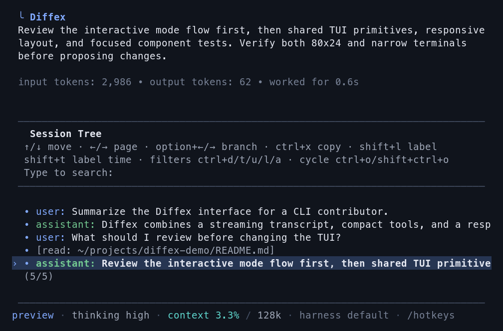

# Sessions

Diffex saves conversations as sessions so you can continue work, branch from earlier turns, and revisit previous paths.

## Session Storage

Sessions auto-save to `~/.diffex/agent/sessions/`, organized by working directory. Each session is a JSONL file with a tree structure.

```bash
diffex -c                  # Continue most recent session
diffex -r                  # Browse and select from past sessions
diffex --no-session        # Ephemeral mode; do not save
diffex --name "my task"    # Set session display name at startup
diffex --session <path|id> # Use a specific session file or partial session ID
diffex --fork <path|id>    # Fork a session file or partial session ID into a new session
```

Use `/session` in interactive mode to see the current session file, session ID, message count, tokens, and cost.

For the JSONL file format and SessionManager API, see [Session Format](session-format.md).

## Session Commands

| Command | Description |
|---------|-------------|
| `/resume` | Browse and select previous sessions |
| `/new` | Start a new session |
| `/name <name>` | Set the current session display name |
| `/session` | Show session info |
| `/subagents` | Show sub-agents in the current session |
| `/tree` | Navigate the current session tree |
| `/fork` | Create a new session from a previous user message |
| `/clone` | Duplicate the current active branch into a new session |
| `/compact [prompt]` | Summarize older context; see [Compaction](compaction.md) |
| `/export [file]` | Export session to HTML |
| `/share` | Upload as a secret GitHub Gist and return its direct URL |

## Sub-agents in Saved Sessions

Saved parent sessions automatically preserve their branch-scoped sub-agent roster and usable child histories. Reopening a parent restores terminal records as recorded and changes children that were queued or running to interrupted. Reopening does not resume provider work, replay the original task, or redeliver a completed result.

An explicit wake resumes a child from its saved history when that history is usable. If the history is missing, unsafe, or invalid, Diffex creates an isolated replacement and runs only the wake message. A wake uses the child's complete captured model, thinking level, tools, and harness when all remain usable; otherwise it uses the complete current parent configuration and reports a warning rather than mixing configurations.
Restored and replacement children receive the child-only `escalate_to_parent` tool only after an explicit wake starts a live run.

Escalation reports delivered to the root are hidden from the transcript but are not secret or redacted.
Accepted idle reports, delivered active reports, and the child's tool-call arguments remain normal session history.
An idle report in a saved session is appended to the currently selected parent branch without starting a provider call and is supplied to the parent on its next explicit run; an in-memory parent keeps the report only in the live session.
Branch navigation retains only the selected branch's pending saved reports for capacity accounting.
Deleting a parent session continues to delete its parent history and owned child-session namespace through the normal parent-owned deletion behavior.

Branch navigation and session-context resets reconcile the roster only after the transition is safe. In-memory parents and `--no-session` sessions keep sub-agents ephemeral. Setting `subagents: false` disables the sub-agent tools without erasing a saved roster.

## Resuming and Deleting Sessions

`/resume` opens an interactive session picker for the current project. `diffex -r` opens the same picker at startup.

In the picker you can:

- search by typing
- toggle path display with Ctrl+P
- toggle sort mode with Ctrl+S
- filter to named sessions with Ctrl+N
- rename with Ctrl+R
- delete with Ctrl+D, then confirm

When available, Diffex uses the `trash` CLI for deletion instead of permanently removing files.

## Naming Sessions

Use `/name <name>` to set a human-readable session name:

```text
/name Refactor auth module
```

Set the name at startup with `--name` or `-n`:

```bash
diffex --name "Refactor auth module"
diffex --name "CI audit" -p "Review this build failure"
```

Named sessions are easier to find in `/resume` and `diffex -r`.

## Branching with `/tree`

Sessions are stored as trees. Every entry has an `id` and `parentId`, and the current position is the active leaf. `/tree` lets you jump to any previous point and continue from there without creating a new file.

<p align="center"></p>

Example shape:

```text
├─ user: "Hello, can you help..."
│  └─ assistant: "Of course! I can..."
│     ├─ user: "Let's try approach A..."
│     │  └─ assistant: "For approach A..."
│     │     └─ user: "That worked..."  ← active
│     └─ user: "Actually, approach B..."
│        └─ assistant: "For approach B..."
```

### Tree Controls

| Key | Action |
|-----|--------|
| ↑/↓ | Navigate visible entries |
| ←/→ | Page up/down |
| Ctrl+←/Ctrl+→ or Alt+←/Alt+→ | Fold/unfold or jump between branch segments |
| Shift+L | Set or clear a label on the selected entry |
| Shift+T | Toggle label timestamps |
| Enter | Select entry |
| Escape/Ctrl+C | Cancel |
| Ctrl+O | Cycle filter mode |

Filter modes are: default, no-tools, user-only, labeled-only, and all. Configure the default with `treeFilterMode` in [Settings](settings.md).

### Selection Behavior

Selecting a user or custom message:

1. Moves the leaf to the selected message's parent.
2. Places the selected message text in the editor.
3. Lets you edit and resubmit, creating a new branch.

Selecting an assistant, tool, compaction, or other non-user entry:

1. Moves the leaf to that entry.
2. Leaves the editor empty.
3. Lets you continue from that point.

Selecting the root user message resets the leaf to an empty conversation and places the original prompt in the editor.

## `/tree`, `/fork`, and `/clone`

| Feature | `/tree` | `/fork` | `/clone` |
|---------|---------|---------|----------|
| Output | Same session file | New session file | New session file |
| View | Full tree | User-message selector | Current active branch |
| Typical use | Explore alternatives in place | Start a new session from an earlier prompt | Duplicate current work before continuing |
| Summary | Optional branch summary | None | None |

Use `/tree` when you want to keep alternatives together. Use `/fork` or `/clone` when you want a separate session file.

## Branch Summaries

When `/tree` switches away from one branch to another, Diffex can summarize the abandoned branch and attach that summary at the new position. This preserves important context from the path you left without replaying the whole branch.

When prompted, choose one of:

1. no summary
2. summarize with the default prompt
3. summarize with custom focus instructions

See [Compaction](compaction.md) for branch summarization internals and extension hooks.

## Session Format

Session files are JSONL and contain message entries, model changes, thinking-level changes, labels, compactions, branch summaries, and extension entries.

For parsers, extensions, SDK usage, and the full SessionManager API, see [Session Format](session-format.md).
